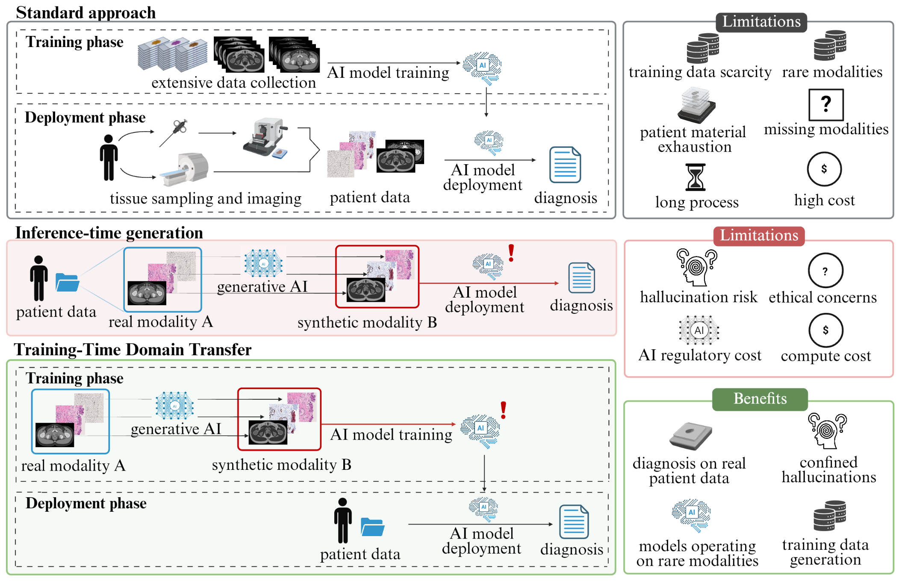
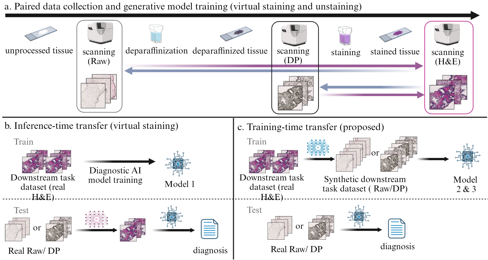

# TRAINING-TIME DOMAIN TRANSFER FOR GENERATOR-FREE DIAGNOSTICS ON NOVEL MODALITIES IN COMPUTATIONAL PATHOLOGY

## Abstract

Novel imaging modalities promise improved diagnostics, but AI development is constrained by scarce training data. Inference-time domain transfer can address this by mapping novel modalities to established ones, enabling reuse of existing diagnostic models. However, this introduces hallucination risks, computational overhead, and regulatory complexity.

Inspired by sim-to-real transfer, we propose **training-time domain transfer**, generating synthetic target-domain training data from archived routine samples to enable direct diagnosis on real inputs without inference-time generation.

Using unstained prostate histopathology as a proof-of-concept, we compare this approach with inference-time virtual staining and conventional H&E-based cancer detection. Training-time transfer achieved higher concordance with the conventional benchmark than virtual staining for both raw (Cohen's κ=0.59 vs. 0.37; Gwet's AC1=0.73 vs. 0.29) and deparaffinized tissue (κ=0.66 vs. 0.61; AC1=0.73 vs. 0.64), supporting its potential for emerging diagnostic modalities.



*Standard approach, inference-time generation and training-time domain transfer, with their limitations and benefits.*

## Overview



*(a) Paired data collection (raw, deparaffinized and H&E scans of the same tissue) and generative model training in both directions. (b) Inference-time transfer (virtual staining). (c) Training-time transfer (proposed).*

The pipeline has two parts:

1. **Generative model** (this repository): paired image-to-image translation between unstained and H&E-stained tissue, used for virtual staining (inference-time baseline) and virtual unstaining (training-time transfer).
2. **Diagnostic model** (built on Mulliqi et al., see [below](#diagnostic-model)): a multiple instance learning model adapted to benign vs. malignant classification, trained on H&E slides either directly or on synthetic unstained images produced by the generative model.

This repository contains the code of the generative model:

| Script | Purpose |
|---|---|
| `virtual_staining_unstaining.py` | Trains the paired image-to-image translation models (virtual staining and virtual unstaining): a Pix2Pix-style conditional GAN on paired tiles of the same tissue before and after staining. |
| `inference.py` | Applies a trained model to tiles stored as TFRecords: H&E → synthetic unstained (training-time transfer) or unstained → synthetic H&E (virtual staining). |

## Installation

```
pip install -r requirements.txt
```

---

## Generative model

### Built on

- **Pix2Pix** (Isola et al., "Image-to-Image Translation with Conditional Adversarial Networks", CVPR 2017): training scheme with a conditional PatchGAN discriminator and GAN + L1 loss. We add a Pearson correlation (PCC) loss term.
- **U-Net##** (Korkmaz, "U-Net##: A Powerful Novel Architecture for Medical Image Segmentation", MICAD 2022): the generator `UNetSharpSharp2D` and its building blocks (`conv_block`, `down_conv`, `up_conv`, `inter_conv`) are taken from [`model/UNetSharpSharp2D.py` at commit c6c1304](https://github.com/kaijiu1013/UNetSharpSharp/blob/c6c1304e1eb331c2076fde7af8db436d1275ab2d/model/UNetSharpSharp2D.py) of the U-Net## code by Fırat Korkmaz (MIT license).

### Training

#### Data format

Training needs a CSV with one row per pair of tiles, and a root folder with the tile images:

```
slide_id,unstained,stained
slideA,slideA/unstained/tile_0001.png,slideA/stained/tile_0001.png
slideA,slideA/unstained/tile_0002.png,slideA/stained/tile_0002.png
slideB,slideB/unstained/tile_0001.png,slideB/stained/tile_0001.png
```

- `slide_id`: the slide the tile comes from.
- `unstained`, `stained`: paths relative to `--tiles_folder`. The two tiles of a pair must be registered (aligned) and have the same size.

The pairs are split 80/20 by slide into `--train_csv` and `--val_csv`, which are reused on later runs.

#### Running

```
python virtual_staining_unstaining.py \
    --run_name stained2unstained_run1 \
    --direction stained2unstained \
    --pairs_csv pairs.csv \
    --tiles_folder /path/to/tiles \
    --train_csv splits/train.csv \
    --val_csv splits/val.csv \
    --model_save_dir checkpoints/ \
    --output_dir outputs/ \
    --devices 1
```

Run `python virtual_staining_unstaining.py --help` for all options. Defaults: 100 epochs, learning rate 0.0002, L1 weight 100, PCC weight 10, batch size 1 per GPU on 4 GPUs (effective batch size 4), 4 workers, seed 1. Add `--wandb_project <name>` to log to Weights & Biases.

| `--direction` | Model input (source) | Ground truth (target) | Used in the study for |
|---|---|---|---|
| `stained2unstained` (default) | stained (H&E) | unstained | training-time transfer (synthetic unstained data) |
| `unstained2stained` | unstained | stained (H&E) | inference-time transfer (virtual staining) |

Train one model per direction. Training uses random flips and 90-degree rotations as augmentation.

#### Outputs

- Checkpoints, every epoch, in `--model_save_dir`.
- Example images in `--output_dir/train_outputs/` (second batch of each epoch) and `--output_dir/val_outputs/`, named `source_*` (model input), `generated_*` (model output) and `target_*` (ground truth). In the validation folder, `source_*` and `target_*` are saved only for epoch 0.

The validation split is used to monitor training. To evaluate a trained model, apply it to external test data with `inference.py`.

### Inference: generating synthetic images

`inference.py` applies a trained checkpoint to whole slides of tiles. Set `--direction` to the direction the checkpoint was trained with (a warning is printed if they differ):

| `--direction` | Input tiles | Output |
|---|---|---|
| `stained2unstained` (default) | H&E | synthetic unstained |
| `unstained2stained` | unstained (raw or deparaffinized) | synthetic H&E |

#### Input layout

```
input_dir/
  <wsi_id>/<wsi_id>.tfrecord     # one TFRecord per slide
```

Each record holds `tile_id` (bytes, e.g. `<wsi_id>_<y1>_<y2>_<x1>_<x2>.jpg`) and `image` (encoded 1024×1024 RGB tile).

#### Processing

For each tile: optional stain augmentation → model → split the 1024×1024 output into a 2×2 grid of 512×512 crops → resize each crop to 256×256 (Lanczos) → JPEG (quality 90). Each crop is renamed with its own coordinates in the slide, `<wsi_id>_<y1>_<y2>_<x1>_<x2>.jpg`.

Output: one TFRecord per slide, `output_dir/<wsi_id>/<wsi_id>.tfrecord`.

#### Running

```
python inference.py \
    --direction stained2unstained \
    --checkpoint checkpoints/stained2unstained_run1-epoch=99.ckpt \
    --input_dir /path/to/he_tfrecords \
    --output_dir /path/to/synthetic_unstained
```

Options:

- `--reference_dir`: keep only crops whose `tile_id` appears in the reference TFRecord of the same slide.
- `--stain_augmentation`: random HED stain augmentation of 50% of slides (H&E input only); `--seed` makes it reproducible.
- `--chunk_start`, `--chunk_end`: process a subset of slides, e.g. to split work across jobs.

Run `python inference.py --help` for all options.

---

## Diagnostic model

The diagnostic model follows the multiple instance learning approach of Mulliqi et al., adjusted to benign vs. malignant classification, whereas the original approach predicts the Gleason score (ISUP grade). It uses an EfficientNet-V2-S feature extractor followed by gated attention. The diagnostic model is **not** part of this repository.

**The original model training information and the training and tuning cohort specifications can be found in:**

> N. Mulliqi et al., "Comparative analysis of end-to-end learning and foundation models for clinical-grade prostate pathology," *Nature Communications*, 2026, doi: [10.1038/s41467-026-78996-7](https://doi.org/10.1038/s41467-026-78996-7).

In this study, the diagnostic model was trained on H&E whole-slide images, either directly (H&E benchmark and inference-time virtual staining) or after virtual unstaining of the H&E slides with the generative model above (training-time domain transfer), in which case it is trained solely on synthetic data. Ten cross-validation models were ensembled, and the decision threshold was optimized for F1 on a tuning set. The training and tuning cohorts share no patients with the STHLM3-SFH test set.

## Acknowledgements

- Pix2Pix: Isola et al., CVPR 2017.
- U-Net## generator: Fırat Korkmaz, [UNetSharpSharp2D.py @ c6c1304](https://github.com/kaijiu1013/UNetSharpSharp/blob/c6c1304e1eb331c2076fde7af8db436d1275ab2d/model/UNetSharpSharp2D.py), MIT license, Copyright (c) 2023 Fırat Korkmaz.
